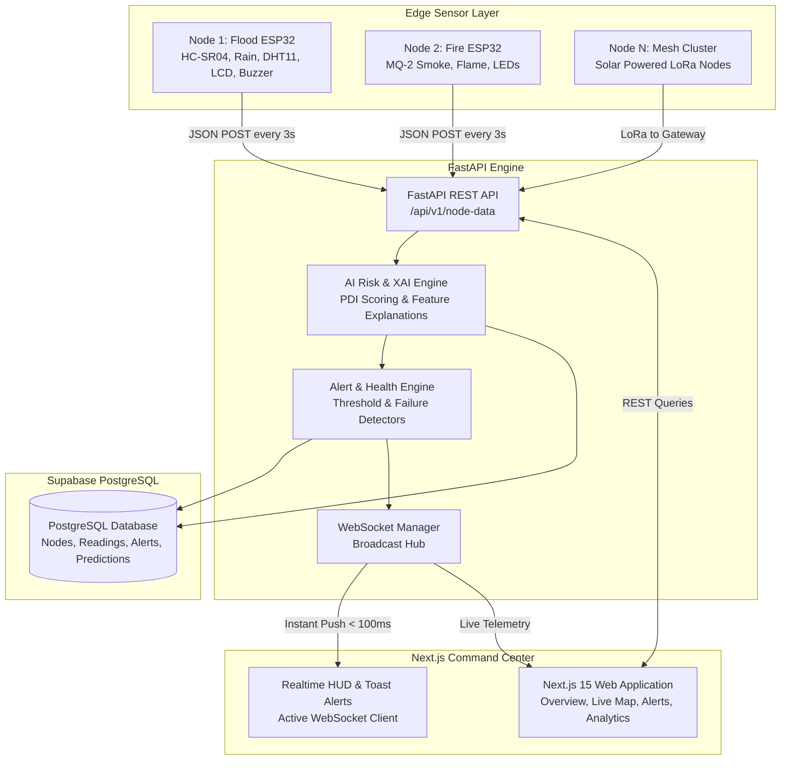

# EcoSentinel AI — System Architecture & Data Flow

EcoSentinel AI is an AI-powered Multi-Hazard Environmental Monitoring Platform engineered for sub-2-second disaster early warning, spatial danger perimeter modeling, and automated emergency dispatch.

---

## High-Level Architecture

---

## Core Components

### 1. Edge Layer (ESP32 Nodes)
- **Node 1 (Flood Node)**: Reads HC-SR04 ultrasonic distance, rain analog/digital state, and DHT11 temperature/humidity. Executes on-device risk rules (Rain + Water > Threshold = HIGH risk), activates local LEDs/buzzer, updates 16x2 LCD, and transmits JSON telemetry every 3 seconds.
- **Node 2 (Fire Node)**: Reads MQ-2 combustion gas / smoke concentration (PPM). Triggers localized danger indicators and transmits JSON telemetry every 3 seconds.
- **Resilience**: Watchdog Timer (WDT), non-blocking FreeRTOS loops, automatic WiFi reconnection, and OTA support.

### 2. Ingestion & AI Engine (FastAPI)
- **High-Throughput Async REST Ingestion**: Ingests JSON packets from thousands of edge nodes asynchronously.
- **AI Hazard Scoring**: Calculates Flood Risk, Fire Risk, and Overall Projected Disaster Index (PDI) with transparent feature weights (e.g. *"High Risk because Water Level (63cm) exceeds 60cm threshold and active rainfall is detected"*).
- **Automated Alerts**: Evaluates severity levels (`low`, `medium`, `high`, `critical`) and initiates emergency dispatch.

### 3. Real-Time WebSocket Hub
- Broadcasts telemetry updates, risk score changes, and critical emergency alerts directly to all connected dashboard clients with zero polling and zero page refresh.

### 4. Command Center (Next.js 15)
- **Overview**: Real-time KPI summaries, AI health gauge, and threat radar.
- **Live GIS Map**: Interactive markers color-coded by hazard risk (`green`, `orange`, `red`) with detailed sensor popup cards.
- **Alerts Feed**: Chronological incident timeline with severity filters and export capabilities.
- **Analytics & History**: Multi-sensor time-series charts and seasonal trend comparisons.
- **Digital Twin & Settings**: Comprehensive node lifecycle management and configurable alert thresholds.
